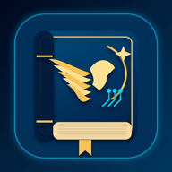

<p align="center"></p>

# Agentic Compendium

**A self-hosted, responsive PWA for organising Hermes cron-job results and personal notes.**

Agentic Compendium is a single-container application with a Python standard-library HTTP server, persistent SQLite and an offline-capable browser client. It works on phones, tablets and desktops without a commercial Apple Developer account. It is designed to run privately behind your existing LAN or VPN HTTPS reverse proxy.

## Features

- **Channels and sections:** Create sections, drag and drop channels, reorder them and move them between sections. Touch-friendly Move Up, Move Down and section selection controls are also available.
- **Rich reading:** Read Hermes deliveries grouped by channel and day, with formatted Markdown headings, lists, tables, links and code. Export Rich Text Format (`.rtf`) documents.
- **Organise safely:** Search, multi-select, move, mark read/unread, send items to Bin and restore them without deleting source deliveries or notes.
- **Personalise:** System, Light and Dark modes, five accent colours, collapsible desktop/tablet sidebars, and responsive phone navigation.
- **Private multi-device sync:** Incremental SQLite change cursors, optimistic revisions, tombstones, offline IndexedDB cache and immediate local note saves. Visible pending status and conflict review let you keep your draft, download it or use the synced version.
- **Portable PWA archives:** Export deliveries, notes, channels, tombstones and original native archives from Settings. Import into another instance without overwriting conflicting data. Credentials and sessions are excluded; connect Hermes separately after importing.
- **Hermes integration:** Optional dashboard connection and selective import of completed cron runs; Hermes remains responsible for schedules and execution. Settings shows connection health, last successful checks, import results and actionable errors, with a manual connection check.
- **Browser notifications:** Opt in on each device for generic, encrypted Web Push alerts when new deliveries arrive. Enable, test and disable from Settings. Titles and delivery content stay in your private archive.
- **Native archives:** Import a portable export from a native Agentic Compendium App installation. Original PencilKit drawing bytes are retained without activating a web drawing interface.
- **Account management:** Username/password owner sign-in, salted PBKDF2-SHA256 verification, revocable sessions and credential changes in Settings.

## Quick start

You need Docker Engine with the Compose plugin, and HTTPS via a reverse proxy that you control.

```bash
git clone https://github.com/muhdusama/Agentic-Compendium.git
cd Agentic-Compendium
cp .env.example .env
chmod 600 .env
```

Edit `.env` to replace all three example credential values with independently generated secrets (`openssl rand -hex 32`). Set `APP_PUBLIC_ORIGIN` to the **exact HTTPS origin** used in your browser, with no trailing slash. Configure `APP_HERMES_ALLOWED_ORIGINS` to your actual HTTPS Hermes dashboard origin, or leave it empty to disable new Hermes connections. Set `APP_BIND_IP` to `127.0.0.1` when the HTTPS proxy runs on the same host, or to your private LAN address when the proxy runs on another trusted machine.

```bash
docker compose --env-file .env up -d --build
```

Visit **`https://your-host.example/app/`**, then sign in as **`owner`** with the `APP_OWNER_PASSWORD` from your private `.env`. You can change the username and password in Settings. The bootstrap password is stored as a salted verifier in the SQLite database on first run, and changing it does not reset it on subsequent container restarts.

## Persistent host storage

```text
Agentic-Compendium/
├── Dockerfile
├── compose.yaml
├── .env                   # secret, untracked
├── server/                # public application source
└── data/                  # private, untracked host directory
    └── deliveries.sqlite3
```

Compose mounts **`./data:/data`**. No Docker-managed volume, second application container or external database is required. Back up the SQLite database using a *consistent SQLite backup*, especially while the application is running. Do not commit or publish `data/`, `.env`, downloaded exports, user notes or API tokens.

## Important security boundaries

- This is a **single-owner** application. Keep it on LAN/VPN HTTPS and do not expose the backend port or SQLite directory to the public Internet.
- The owner web session uses HttpOnly, SameSite cookies, origin checks and server-side session revocation. Existing delivery-read and delivery-publish bearer tokens are separate credentials.
- Hermes dashboard credentials are held in the private server database, not shipped in the web application. Treat the database and its filesystem backups as credential-bearing secrets. Only allowlisted HTTPS Hermes origins are accepted.
- Web Push uses the browser's push service (Google, Mozilla or Apple). The server needs outbound HTTPS to that service; no public inbound push endpoint is needed. VAPID keys and device subscriptions stay in the private database and are excluded from portable archives. Sign-out disables the current device's subscription; changing the owner account disables all devices. The browser still needs LAN/VPN access to open your private archive.
- Offline browser storage is device-local and may contain sensitive delivery content. Avoid using shared devices; signing out is not a guarantee of device-storage erasure.
- Native PencilKit data and historical web drawings are retained on import but are not editable in the PWA.
- Hermes currently only exposes a bounded recent-run history for some deployments. This client does not promise gap-free catch-up after long outages.

## API and development

The legacy delivery APIs remain supported: `GET /healthz`, authenticated `GET /v1/status`, `GET /v1/deliveries` and idempotent `POST /v1/deliveries`. The private PWA uses `/app/api/*` for owner login, revisions, channel/section state, note synchronisation, native imports and Hermes reading.

No Node.js dependency is required at runtime. The browser UI uses standard JavaScript, CSS, IndexedDB and a service worker. The Python server uses `pywebpush` and its pinned dependencies for standard Web Push encryption and VAPID signing. Use Python 3.13 and an isolated virtual environment to run the regressions:

```bash
python3 -m venv .venv
. .venv/bin/activate
python -m pip install -r requirements.txt
python3 -m unittest discover -s server/tests -q
node server/tests/service-worker.cjs
```

The browser smoke tests create and remove their own temporary SQLite database and loopback server. They cover rapid note switching, reloads, offline recovery, concurrent edits, archive downloads/imports, account changes, Hermes status, notification controls and phone/tablet/desktop layouts. Notification permission/provider responses are mocked in the regression suite; these tests do not prove physical-device delivery. Tests must **never** target production data.

```bash
# Install browser test tools separately; they are not runtime dependencies.
npm install --prefix /tmp/compendium-browser --no-audit --no-fund --save-exact playwright@1.62.1
/tmp/compendium-browser/node_modules/.bin/playwright install chromium
PLAYWRIGHT_PACKAGE=/tmp/compendium-browser/node_modules/playwright python3 scripts/browser-smoke.py
```

GitHub Actions runs the publication audit, Python tests, JavaScript syntax checks, disposable browser suite and container build on pushes and pull requests. The browser runner supports `APP01_TEST_BROWSER`, `APP01_TEST_EXECUTABLE` (an already-installed browser) and `APP01_TEST_EVIDENCE` (an output directory outside the source tree).

For a portable export, open **Settings → Export archive** while signed in and connected. Pending changes must sync and conflicts must be resolved first. The JSON contains private content, including original imported drawings; keep it secure. PWA imports and exports are limited to 256 MiB; native imports are limited to 64 MiB. Imports merge only new records. An existing record with different content rejects the whole import. This is a content transfer feature, separate from the host's backup and recovery workflow.

## Contributing and support

Issues and pull requests are welcome. Never include real credentials, private domains, internal IP addresses, personal deliveries or production database exports in reports, screenshots or commits.

**Developed and maintained by [IMUVERSE](https://imuverse.com).**

If the project helps you, [Support the project](https://buymeacoffee.com/muhdusama). The same link is available in the application's lower-left footer and through GitHub's support button.

Licensed under the [MIT License](LICENSE).
